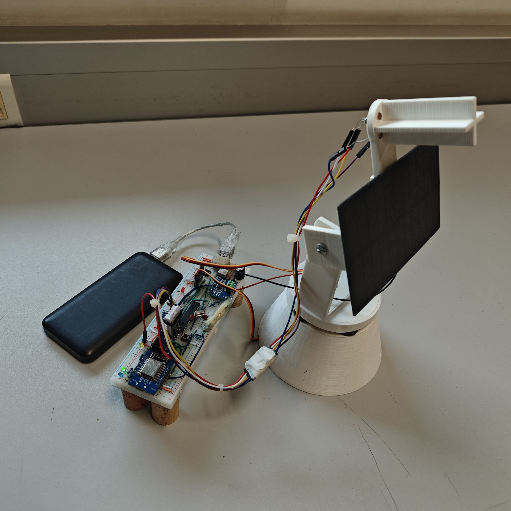
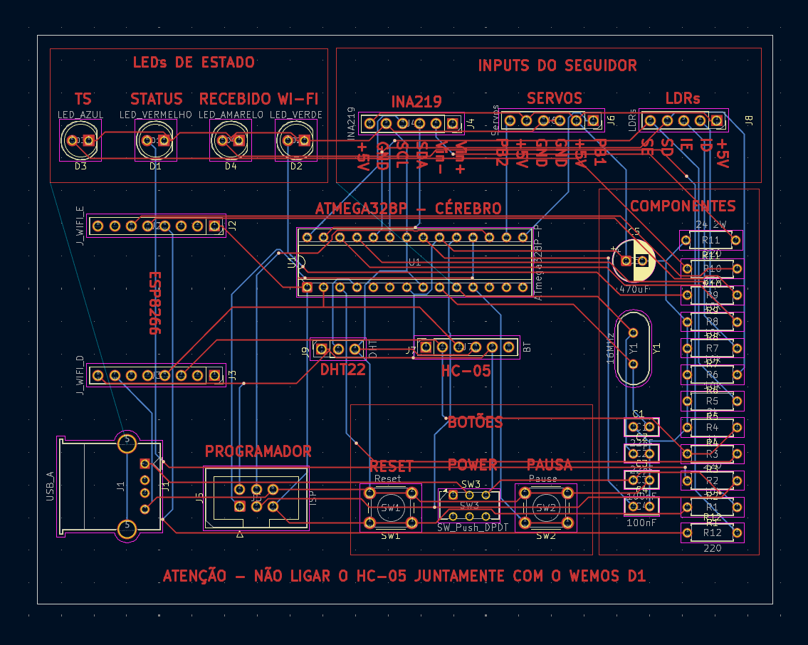

# Dual-Axis IoT Solar Tracker

**Bare-metal ATmega328P firmware with PID control, an ESP8266 IoT gateway (MQTT + ThingSpeak), a custom KiCad PCB and a real-time web dashboard.**

Academic team project for the LABSI course of the BSc in Electrical and Computer Engineering at ISEP (Instituto Superior de Engenharia do Porto), 2025/2026.

🌐 **Project website (live):** <http://ave.dee.isep.ipp.pt/~1221309/LABSI_site/>

| Prototype | PCB |
|---|---|
|  |  |

## What it does

- Tracks the sun on two axes (pan/tilt) using four LDRs in a quadrant layout and two servomotors.
- Runs a **PID controller per axis** with smoothing, dead-band, integral clamping and a per-cycle step limit, with stronger tolerance under very bright light.
- Uses a **state machine** with automatic, manual, pause and night modes, including a parking position at night.
- Monitors **solar panel voltage, current and power** (INA219 over I2C) and **temperature and humidity** (DHT22, decoded by a non-blocking state machine on Timer2).
- Publishes telemetry in real time over **MQTT** and stores history on **ThingSpeak**. The dashboard can also send remote commands.

## Architecture

```text
4x LDR ──ADC──┐
INA219 ──I2C──┤                       ┌── MQTT (HiveMQ) ── WebSockets ──► Web dashboard (live)
DHT22 ─1-Wire─┼─► ATmega328P ──UART──► ESP8266 ─┤
Button ──INT──┤      │                          └── HTTP ── ThingSpeak ──► Web dashboard (history)
              │      └── Fast PWM 50 Hz ──► 2x servos
              └─ (legacy) HC-05 Bluetooth ──► Python desktop app
```

Detailed Mermaid flowcharts (main loop, interrupts, PID, DHT22 state machine, ESP8266, Python app) are in [docs/architecture.md](docs/architecture.md).

## Technical highlights

**ATmega328P firmware** ([firmware/atmega328p/main.c](firmware/atmega328p/main.c)): register-level C with no Arduino libraries.

- Timers and interrupts: a millisecond system tick, a debounced external button interrupt, and a **watchdog**.
- ADC sampling of the four LDRs with per-sensor calibration and exponential smoothing.
- Fast PWM at 50 Hz on Timer1 driving the two servos.
- I2C (TWI) driver with timeouts for the INA219.
- DHT22 protocol decoded without blocking delays.
- Non-blocking UART with a formatted telemetry protocol to the gateway.

**ESP8266 gateway** ([firmware/esp8266/esp8266.ino](firmware/esp8266/esp8266.ino)):

- Wi-Fi multi-network connection.
- MQTT publish/subscribe with JSON payloads (PubSubClient, ArduinoJson).
- NTP time synchronisation with the Portuguese timezone.
- Periodic ThingSpeak uploads and status LEDs.

**Hardware** ([hardware/](hardware/)):

- KiCad schematic and PCB with fabrication files (BOM, positions, netlist, Gerber archive).
- 3D-printable STL parts for the tracker structure.

**Web dashboard** ([dashboard/](dashboard/)):

- HTML, CSS and JavaScript with Chart.js.
- Live MQTT data over WebSockets and ThingSpeak history with date filters.
- Remote manual control.
- Engineering documentation pages with a 3D PCB model.

**Python bridge** ([bridge/app_ponte.py](bridge/app_ponte.py)):

- Desktop app (ttkbootstrap) used by the earlier Bluetooth (HC-05/BLE) version.
- Shows live sensor data and forwards it to ThingSpeak.

## Repository layout

```text
firmware/atmega328p/   bare-metal C firmware (ATmega328P @ 16 MHz)
firmware/esp8266/      Wi-Fi/MQTT/ThingSpeak gateway (Arduino core for ESP8266)
dashboard/             web dashboard and project website
bridge/                Python desktop bridge (Bluetooth -> ThingSpeak)
hardware/kicad/        schematic, PCB and production files
hardware/3d-models/    printable structure parts (STL)
docs/                  architecture and flowcharts, images
```

## Building and running

**ATmega328P**

1. Build `firmware/atmega328p/main.c` with `avr-gcc` (or Microchip Studio) for the `atmega328p` at `F_CPU=16000000UL`.
2. Flash it with a USBasp or another ISP programmer.

**ESP8266**

1. Copy `firmware/esp8266/secrets.example.h` to `secrets.h` and fill in your Wi-Fi network and ThingSpeak write key. `secrets.h` is ignored by Git.
2. Install the `PubSubClient` and `ArduinoJson` libraries.
3. Flash with the Arduino IDE (ESP8266 core).

**Dashboard**

1. Set your ThingSpeak channel and read key in `TS_CONFIG` at the top of `dashboard/script.js`.
2. Open `dashboard/index.html`, or serve the folder with any static server.

**Python bridge**

```bash
pip install -r bridge/requirements.txt
THINGSPEAK_WRITE_KEY=... python bridge/app_ponte.py
```

> Credentials are not part of this repository. Configure your own Wi-Fi network, ThingSpeak channel and keys before running.
> The dashboard's admin lock is a client-side demo only, not real authentication.

## Team

- **Henrique Correia** (1221309)
- **Gonçalo Teixeira** (1221368)

ISEP — Departamento de Engenharia Eletrotécnica.
