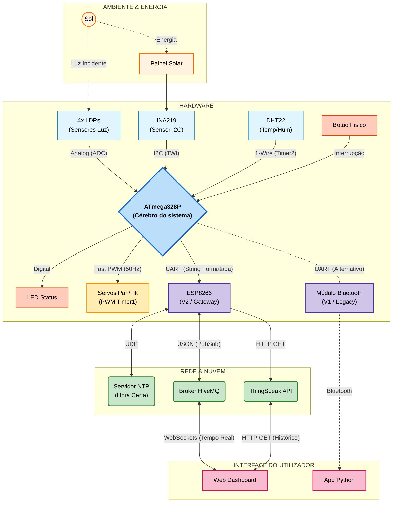
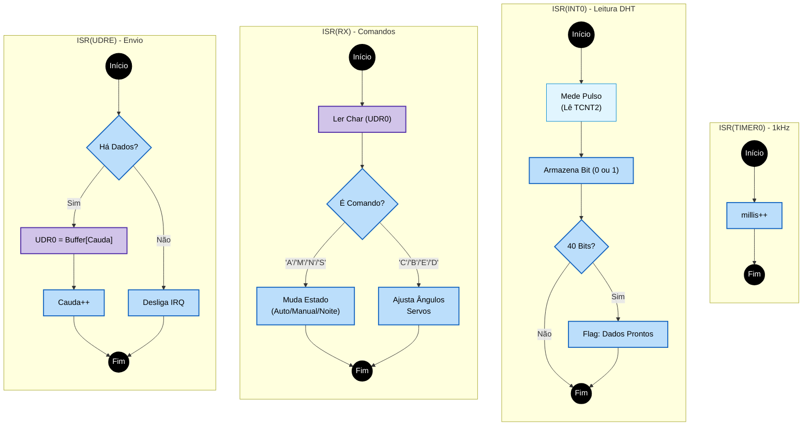
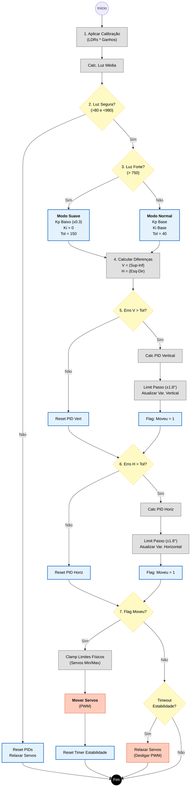
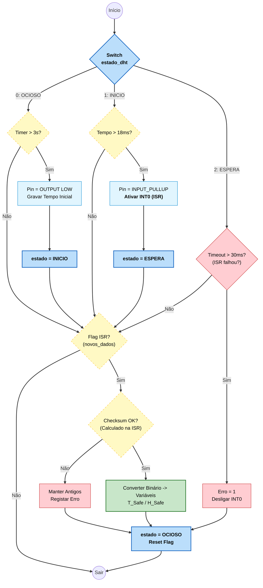
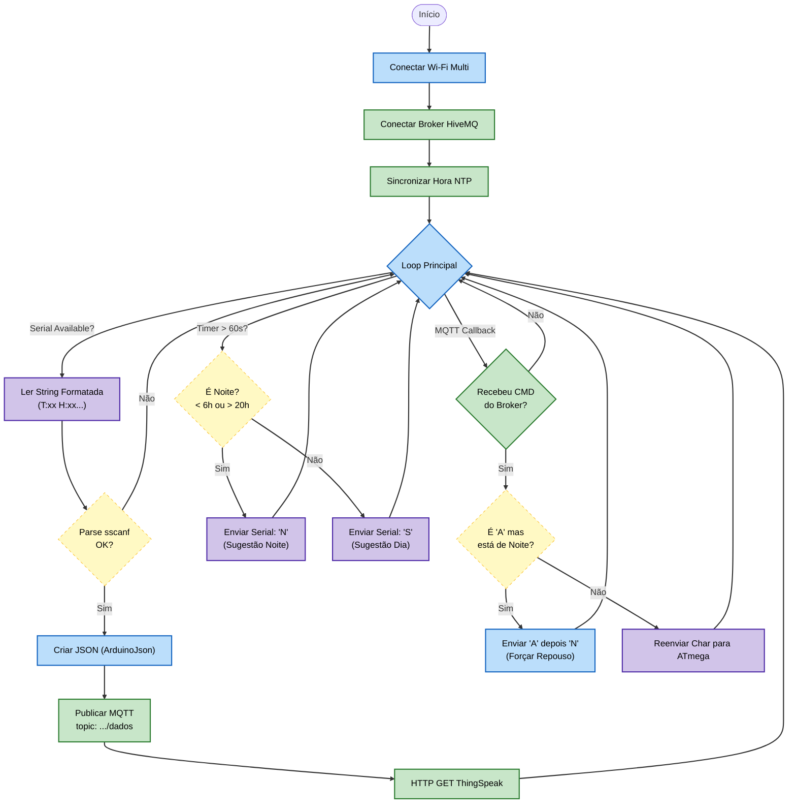
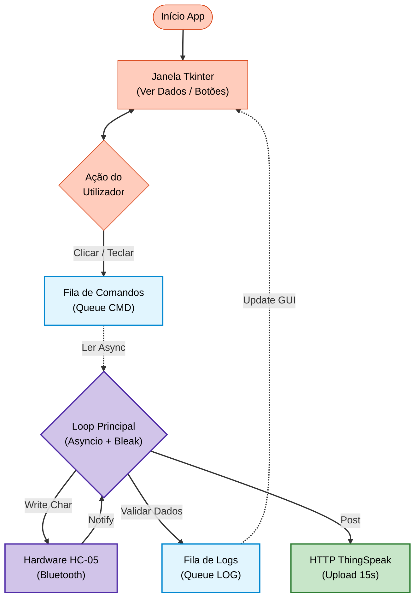

# Architecture and flowcharts

Mermaid diagrams of the system (rendered by GitHub). Labels are in Portuguese, as in the original project.

## 1. Arquitetura Global

## 2. Fluxograma Main-Loop

```mermaid
flowchart TB
  Start(("Start")) --> Setup["Init HW & WDT<br>Centrar Servos"]
  Setup --> Loop(("Loop"))

Loop --> WDT["WDT Reset<br>Get Millis"]

%% LED Heartbeat
WDT --> T_Led{"Timer LED<br>> 500ms?"}
T_Led -- Sim --> Act_Led["Toggle LED"]
T_Led -- Não --> T_Btn

%% Botão Pause
Act_Led --> T_Btn
T_Btn{"Btn Press?<br>(Debounce)"}
T_Btn -- Sim --> Act_Btn["Toggle<br>PAUSE/RESUME"]
T_Btn -- Não --> Act_Sens

%% Sensores LDR (Polling interno)
Act_Btn --> Act_Sens
Act_Sens["Tarefa LDR<br>(ADC)"] --> T_Servo

%% Servos / FSM
T_Servo{"Timer Servo<br>> 50ms?"}
T_Servo -- Sim --> Act_FSM["Máquina Estados<br>Atuação"]
T_Servo -- Não --> T_DHT_Start

%% DHT Lógica Dupla
Act_FSM --> T_DHT_Start
T_DHT_Start{"Timer DHT<br>> 3s?"}
T_DHT_Start -- Sim --> Act_DHT_Req["Pedir Leitura"]
T_DHT_Start -- Não --> Act_DHT_Mgr
Act_DHT_Req --> Act_DHT_Mgr
Act_DHT_Mgr["Gerir Estados<br>DHT (Poll)"] --> T_Comms

%% Comunicação
T_Comms{"Novos Dados<br>DHT?"}
T_Comms -- Sim --> Act_INA["Ler INA219"]
Act_INA --> Act_TX["Format String<br>& UART TX"]
Act_TX --> Loop
T_Comms -- Não --> Loop

%% Estilos
classDef mcu fill:#bbdefb,stroke:#1565c0,stroke-width:2px,color:black
classDef sensor fill:#e1f5fe,stroke:#0288d1,stroke-width:1px,color:black
classDef actuator fill:#ffecb3,stroke:#ff8f00,stroke-width:2px,color:black
classDef comm fill:#d1c4e9,stroke:#512da8,stroke-width:2px,color:black
classDef hmi fill:#ffccbc,stroke:#d84315,stroke-width:1px,color:black
classDef logic fill:#fff9c4,stroke:#fbc02d,stroke-width:1px,color:black,stroke-dasharray: 5 5

class Setup,Loop,WDT,Act_Btn mcu
class Act_Sens,Act_DHT_Mgr,Act_DHT_Req,Act_INA sensor
class Act_FSM,Setup actuator
class Act_TX comm
class Act_Led,T_Btn hmi
class T_Led,T_Servo,T_DHT_Start,T_Comms logic
```

## 3. Fluxograma Interrupções

## 4. Fluxograma PID

## 5. Fluxograma Máquina de Estados DHT22

## 6. Fluxograma ESP8266

## 7. Fluxograma Python

